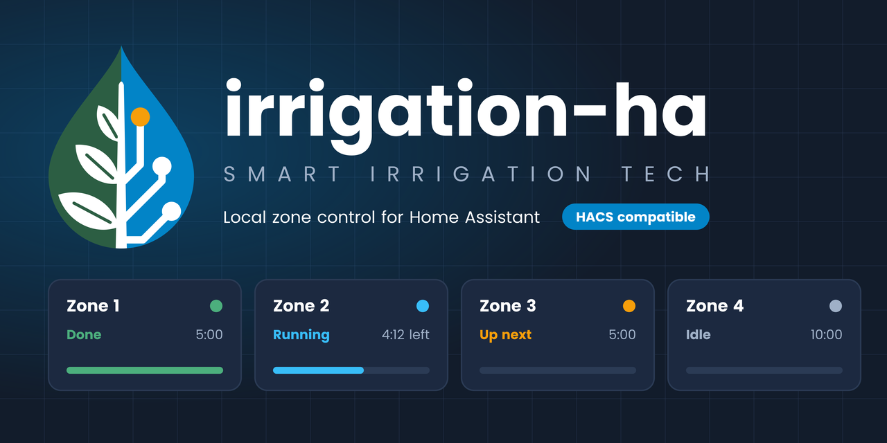
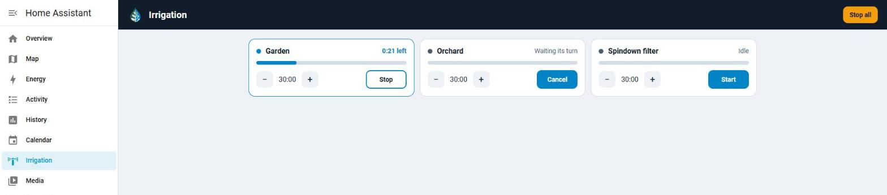
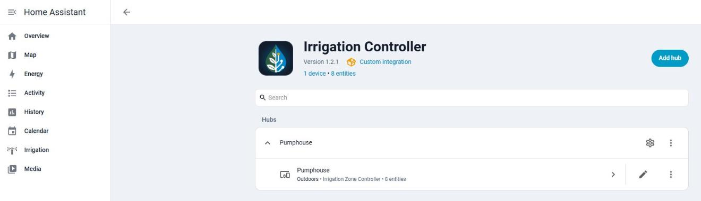
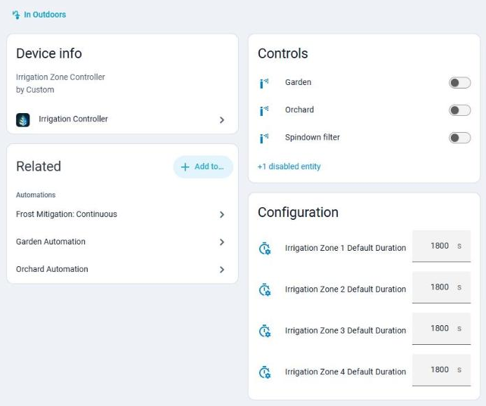
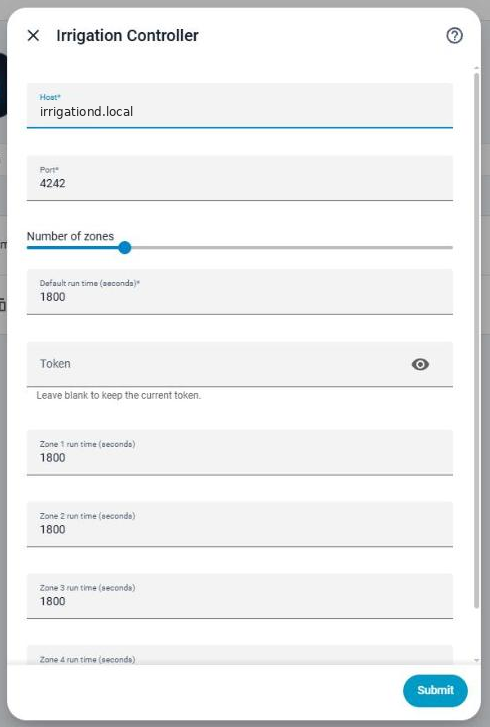
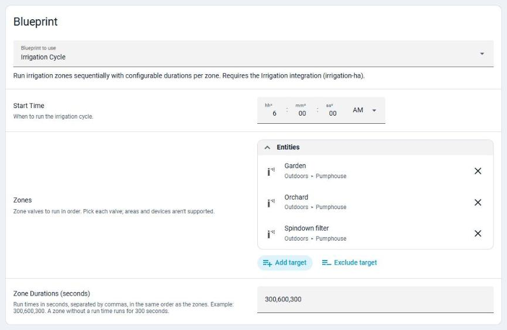

<p align="center">
  
</p>

[](https://hacs.xyz/docs/faq/custom_repositories)
[](https://github.com/jbuck2005/irrigation-ha/releases)
[](./LICENSE)


# Irrigation Controller for Home Assistant

Custom integration that controls irrigation zones by talking to [`irrigationd`](https://github.com/jbuck2005/irrigationd) over your local network.  
Provides:
- An **Irrigation** sidebar panel and a dashboard card for controlling your zones
- **A valve for each zone**, grouped under a single device
- **A default run time for each zone**, with a number entity to change it
- **Zones run one at a time**: starting a zone while another runs queues it, with **Stop all** and **Skip zone** buttons and status sensors
- **Watering programs** with start times, watering days and a run time per zone, set up in the UI
- An optional master valve or pump that opens with every zone
- Commands sent over TLS with the token as the key, when `irrigationd` supports it
- Zone state read from `irrigationd`, so runs started elsewhere show up and survive a Home Assistant restart
- Host, port and token set in the UI, with the token matching `IRRIGATIOND_TOKEN` on the irrigationd host
- A bundled automation blueprint, for setups that need more than programs
- Sprinkler icons that change while a zone is running

<p align="center">
  
</p>

### Requirements
- Home Assistant 2025.3 or later
- [`irrigationd`](https://github.com/jbuck2005/irrigationd) running and reachable from Home Assistant, with a token set and the `STATUS` command, which Home Assistant uses to read zone state
- Up to 14 zones per controller

---

## Installation

Irrigation Controller isn't in the HACS default list yet. It has been submitted ([hacs/default#13725](https://github.com/hacs/default/pull/13725)), and until that's merged you add it as a **custom repository**, as below. Once it's merged, you can search for **Irrigation Controller** without adding the repository first.

### Marketplace (Home Assistant 2026.11 and later)
HACS is built into Home Assistant as the Marketplace from 2026.11. Adding a custom repository needs a GitHub connection.

1. Go to **Settings → Marketplace** and open **Custom repositories**.
2. Add this repository URL:  
   `https://github.com/jbuck2005/irrigation-ha`
3. Select the type **Integration**, and add it.
4. Find **Irrigation Controller**, download it and restart Home Assistant.

### HACS (before 2026.11)
1. Open **HACS**, select the **⋮** menu in the top right, and select **Custom repositories**.
2. Add this repository URL:  
   `https://github.com/jbuck2005/irrigation-ha`
3. Select the type **Integration**, and add it.
4. Find **Irrigation Controller**, download it and restart Home Assistant.

### Manual
1. Copy the `custom_components/irrigation` folder into  
   `/config/custom_components/irrigation/`
2. Restart Home Assistant.

---

## Configuration

After restart, add the integration from the UI:

**Settings → Devices & Services → Add Integration → Irrigation Controller**

You will be asked for:
- **Name** (default: Irrigation Controller)
- **Host**: the address of the irrigationd host, or `127.0.0.1` if it's on the same machine
- **Port** (default: 4242)
- **Number of zones** (default: 4, maximum: 14)
- **Default run time** (seconds, default: 300): the starting run time for every zone
- **Token**: the same value as `IRRIGATIOND_TOKEN` on the irrigationd host, at least 16 characters. `irrigationd`'s `make install` generates one for you
- **Allow the token in plain text** (default: off): only for an `irrigationd` too old for TLS. See [Security and privacy](#security-and-privacy)

These can be changed later under **Configure**, including the token. Leave the token blank to keep the current one.

<p align="center">
  
</p>

### Configuring Individual Zone Durations

After initial setup, you can configure each zone's default duration in two ways:

#### Option 1: Device Page (Recommended)
1. Go to **Settings → Devices & Services → Irrigation Controller**
2. Click on your controller's device, which has the name you gave it at setup
3. You'll see `number.irrigation_zone_X_default_duration` entities for each zone
4. Adjust each zone's duration as needed (10 - 7200 seconds)

<p align="center">
  
</p>

#### Option 2: Configure (Bulk Edit)
1. Go to **Settings → Devices & Services → Irrigation Controller**
2. Click **Configure**
3. You'll see individual run time fields for each zone, from 10 to 7200 seconds
4. Adjust all zones at once and click **Submit**
5. The integration will reload automatically with new settings

If you change **Number of zones**, submit, then open **Configure** again to set run times for the new zones. Until you do, they use the default run time.

<p align="center">
  
</p>

### Master valve or pump

If your system has a master valve or pump, set it under **Configure**. It opens before each zone, after an optional lead time of up to 10 seconds, and closes after it.

Wire it to `irrigationd` and set it as the **master zone** if you can. `irrigationd`'s own timer then closes it with each zone, and no run passes 2 hours, even if Home Assistant crashes or loses its connection.

A **master switch** is a Home Assistant switch instead. It has no timer of its own, so if Home Assistant goes down mid-run, it stays on until Home Assistant starts again and turns it off. If that turn-off fails, **Repairs** shows a notice.

### Programs

A program waters zones on a schedule, with no automation needed. On the controller's integration page, select **Add program** and set:
- **Start times**: up to four a day
- **Days**: every day, chosen weekdays, every few days (counted from the day you save it), or odd or even dates
- **Run time for each zone**, in minutes, up to 120. 0 skips a zone

At each start time, the program's zones run one at a time in zone order, through the same queue as any other run. The master zone is skipped, since it opens with every zone anyway. To change a program, open its **⋮** menu on the integration page and select **Reconfigure**. Changing "every few days" restarts the count from that day.

When clocks go back and an hour repeats, a start time in it runs once. When clocks go forward, a start time in the skipped hour runs at the end of the gap.

Each program is its own device, with a schedule switch, a **Run now** button and next and last run sensors. See [Programs](#programs-1) under Entities.

If Home Assistant restarts while a program is running, its remaining zones are skipped, and a notification says so.

### Changing the token

Generate a new token on the irrigationd host with `openssl rand -hex 16`, set it as `IRRIGATIOND_TOKEN` in `/etc/default/irrigationd` and restart `irrigationd`, then enter the same value under **Configure**. The token field is hidden and starts empty, and leaving it blank keeps the current token. A new token must be at least 16 characters. Until both sides match, commands fail with `ERR token`.

---

## Irrigation panel

After setup, **Irrigation** appears in the sidebar, with nothing else to install or configure. It lists every zone, and from there you can:

- Start or stop a zone, and see the time left
- Change a zone's default run time, from 10 seconds to 2 hours
- Stop everything with **Stop all**, which shows while a zone is running or waiting. It clears the queue, and also stops a zone that's about to start, even in the pause between zones or while the master valve opens

Only one zone per controller runs at a time. Starting another zone shows it as **Waiting its turn**, and it starts when the zones ahead of it finish. Its button changes to **Cancel**. Starting a zone that's already running does nothing. A master valve zone shows as **Master valve** and has no Start button, because it opens with the other zones.

If a command fails, the zone shows a warning with the reason. A warning on a stopped zone means it may still be running, so check the controller.

`irrigationd` keeps a valve open for at most 2 hours in one go, and a zone that reaches that limit can't restart for 10 minutes unless it's stopped first. A run that would pass 2 hours is shortened to fit.

The integration checks the real zone state with `irrigationd` every 15 seconds, so runs started elsewhere show up and a running zone survives a Home Assistant restart. If it can't read the state for 45 seconds, the zones show as unavailable.

To rename a zone, rename its valve in Home Assistant and the panel follows. Reloading a controller, such as after saving **Configure**, closes its zones.

### Dashboard card

To add the same controls to a dashboard, add the **Irrigation Zones** card, or use this YAML:

```yaml
type: custom:irrigation-zones-card
title: Irrigation
```

---

## Entities

A second controller adds its number after `irrigation`, such as `valve.irrigation_2_zone_1`.

### Valves
- `valve.irrigation_zone_X` → Zone valve for each irrigation zone, with the state `open` or `closed`
- Attributes: `remaining` (seconds left), `configured_duration` (the zone's default run time), `run_duration` (the current or last run), `queued` (waiting its turn), `master` (it's the master valve) and `zone` (its number)

### Buttons
- `button.irrigation_stop_all` clears the queue and closes every zone and the master valve
- `button.irrigation_skip` ends the running zone early and starts the next one in the queue

### Sensors
- `sensor.irrigation_status` is `idle` or `running`, with `current_zone`, `ends_in` (seconds) and `queue` attributes
- `sensor.irrigation_queued_runs` counts the runs waiting, with their total `queued_seconds`

### Programs
Each program `<name>` has:
- `switch.irrigation_program_<name>` turns its schedule on and off. Turning it off doesn't stop a run that has started. Attributes: `running`, `start_times` and `days`
- `button.irrigation_program_<name>_run_now` runs it now, even with its schedule off
- `sensor.irrigation_program_<name>_next_run` and `sensor.irrigation_program_<name>_last_run` are timestamps. Next run is unknown while the schedule is off

`sensor.irrigation_status` also has a `program` attribute naming the program that's running.

### Actions
- `valve.open_valve` runs a zone for its default run time
- `irrigation.run` runs one or more zones, with an optional `duration` from 10 to 7200 seconds. Zones beyond the first wait in the queue, and a zone that's already running is left as it is
- `valve.close_valve` stops a running zone, which starts the next one, or cancels a waiting one
- `irrigation.stop_all` clears every controller's queue and closes all zones and master valves
- `irrigation.run_program` targets a program's switch and runs the program now, even with its schedule off. It's refused if the program is already running

If `irrigationd` refuses a command, the action fails with its reply, which stops an automation at that step. Add `continue_on_error: true` to a step that should carry on regardless. The blueprint already does this.

### Number Entities
- `number.irrigation_zone_X_default_duration` → Configure default run time for each zone individually. A second controller's are named like `number.irrigation_2_zone_1_default_duration`
- Adjustable from 10 seconds to 2 hours (7200 seconds)
- Changes apply to the next run
- Persisted across Home Assistant restarts
- Accessible in Settings → Devices & Services → Irrigation Controller, on your controller's device

### Per-Zone Configuration Benefits
- **Different watering needs**: Set longer durations for lawn zones, shorter for drip irrigation
- **Seasonal adjustments**: Easily adjust individual zone times without reconfiguring the whole integration
- **Quick access**: Modify zone durations directly from the device page or entity cards
- **Automation friendly**: Use the number entities in automations to dynamically adjust watering schedules

---

## Building your own dashboard

The panel and the **Irrigation Zones** card cover most needs. To build your own view instead, start from this YAML for a **Manual card**:

```yaml
type: vertical-stack
cards:
  - type: entities
    title: Irrigation Zones
    entities:
      - entity: valve.irrigation_zone_1
        name: Front Lawn
      - entity: valve.irrigation_zone_2
        name: Back Lawn
      - entity: valve.irrigation_zone_3
        name: Garden Beds
  - type: history-graph
    title: Irrigation History
    entities:
      - entity: valve.irrigation_zone_1
      - entity: valve.irrigation_zone_2
      - entity: valve.irrigation_zone_3
    hours_to_show: 24
```

You can extend this with custom cards (e.g. `bar-card`) to show countdown timers
and progress bars per zone.

### Brand colours

An optional theme, [`docs/brand/irrigation-theme.yaml`](docs/brand/irrigation-theme.yaml), applies the project palette to your dashboards and adds `--irrigation-*` CSS variables for cards. See the [brand guide](docs/BRAND.md#lovelace-colours) for setup.

---

## Automation Blueprint

The built-in [programs](#programs) replace this blueprint for most people. Use it if you need conditions or triggers that programs don't offer.

A ready-to-use blueprint is bundled in this repo:

📂 `blueprints/automation/irrigation/irrigation_cycle.yaml`

It runs zones one after another at a scheduled time. To import it, go to **Settings → Automations & scenes → Blueprints → Import blueprint** and paste this URL:

`https://github.com/jbuck2005/irrigation-ha/blob/main/blueprints/automation/irrigation/irrigation_cycle.yaml`

Then create an automation from **Irrigation Cycle**.

<p align="center">
  
</p>

### Example setup

- Start Time: `06:00:00`
- Zones: select all your irrigation zone valves
- Durations: `300,600,300`

This will:
1. Run Zone 1 for 300s
2. Run Zone 2 for 600s
3. Run Zone 3 for 300s

Durations are comma-separated, in the same order as the zones, without brackets. A zone with no duration runs for 300 seconds. If a zone is refused, the cycle moves on to the next one.

Pick the zone valves one by one. Choosing an area or a device in the zone picker runs nothing.

Because zones queue, an automation can also call `irrigation.run` once with several zones, and they run one after another, each for its default run time unless a duration is given.

### YAML snippet

```yaml
use_blueprint:
  path: jbuck2005/irrigation_cycle.yaml
  input:
    start_time: "06:00:00"
    zones:
      entity_id:
        - valve.irrigation_zone_1
        - valve.irrigation_zone_2
        - valve.irrigation_zone_3
    durations: "300,600,300"
```

---

## Updating and removing

- **Update** from HACS or the Marketplace, then restart Home Assistant. If the panel still looks old, refresh the browser.
- **Remove** a controller under **Settings → Devices & Services → Irrigation Controller**. Removing the last one also removes the **Irrigation** sidebar panel. Then uninstall it from HACS or the Marketplace.

---

## Troubleshooting

- **Commands fail with `ERR token`**: the token in Home Assistant doesn't match `IRRIGATIOND_TOKEN` on the irrigationd host. See [Changing the token](#changing-the-token).
- **Zones show as unavailable**: Home Assistant couldn't read zone state from `irrigationd` for 45 seconds. Check that `irrigationd` is running, and that the host and port under **Configure** are right.
- **A stopped zone shows a warning in the panel**: the stop command failed, so the valve may still be open. Check the controller.
- **A zone won't restart**: it reached the 2-hour limit and can't run again for up to 10 minutes unless it's stopped first.
- **A zone shows "Waiting its turn"**: another zone on the same controller is running. Use **Skip zone** to move on, or **Stop all** to clear the queue.
- **A Repairs notice says the master switch didn't turn off**: Home Assistant couldn't turn off your master switch after starting. If it's a pump, turn it off by hand now.
- **A notification says a program was interrupted**: Home Assistant restarted mid-program, so the zones that hadn't run yet were skipped. Start those zones from the panel, or use **Run now** to run the whole program again.
- **A Repairs notice says the token is sent in plain text**: see [Security and privacy](#security-and-privacy).
- **A Repairs notice says the token is too short**: generate a new one, as in [Changing the token](#changing-the-token).
- **A new controller can't connect, and the log says plain text is turned off**: its `irrigationd` is too old for TLS. Update `irrigationd`, or turn on **Allow the token in plain text** under **Configure** for now.
- **Commands fail with `ERR server busy`**: `irrigationd` has too many connections open. Set `IRRIGATIOND_TRUSTED_ADDR` to Home Assistant's address, and look for a device on your network connecting to it repeatedly.

Logs are under **Settings → System → Logs**. The token is never written to them. Remove host names and addresses before sharing logs.

---

## Security and privacy

- Everything stays on your local network. The integration talks only to `irrigationd`, and sends nothing to the internet.
- With an `irrigationd` that supports TLS, every command goes over TLS 1.3 using the token as the key, so the token never crosses the network and nobody on it can read, change or replay commands. There are no certificates to set up.
- An older `irrigationd` without TLS needs the token in plain text, where anyone on the network can read it. Home Assistant only sends it that way if **Allow the token in plain text** is on under **Configure**. It's off for new controllers, which then can't reach an old `irrigationd` until it's updated. Controllers added before this option keep working as they did.
- While the token goes in plain text, Home Assistant shows a notice under **Settings → Repairs**. Once Home Assistant has used TLS with a controller, it never sends that controller the token in plain text again. After updating `irrigationd`, add `IRRIGATIOND_PLAIN_TOKEN=no` to `/etc/default/irrigationd` and restart it.
- A token shorter than 16 characters could be guessed offline from one recorded connection. A short token you already have keeps working, with a Repairs notice until you [change it](#changing-the-token).
- Either way, keep `irrigationd` reachable only from your local network, never from the internet. To let only Home Assistant connect, run `sudo systemctl edit irrigationd` on the irrigationd host, add `IPAddressDeny=any` and `IPAddressAllow=localhost <Home Assistant address>` under `[Service]`, and restart it.
- Home Assistant stores the token in its configuration, like other integrations' credentials. The token field is hidden in the UI and never sent back to the browser.
- `irrigationd` limits failed token attempts, closes each connection after 5 seconds, and allows at most 16 connections at once and 4 from one address. The last 4 slots are kept for addresses that used the token in the last 15 minutes, such as Home Assistant, so devices without the token can't shut it out. Also set `IRRIGATIOND_TRUSTED_ADDR` on the irrigationd host to Home Assistant's address, so failed attempts from elsewhere never block it, even right after `irrigationd` restarts.

To report a security problem, see the [security policy](SECURITY.md).

---

## License

MIT © 2025–2026 jbuck2005
